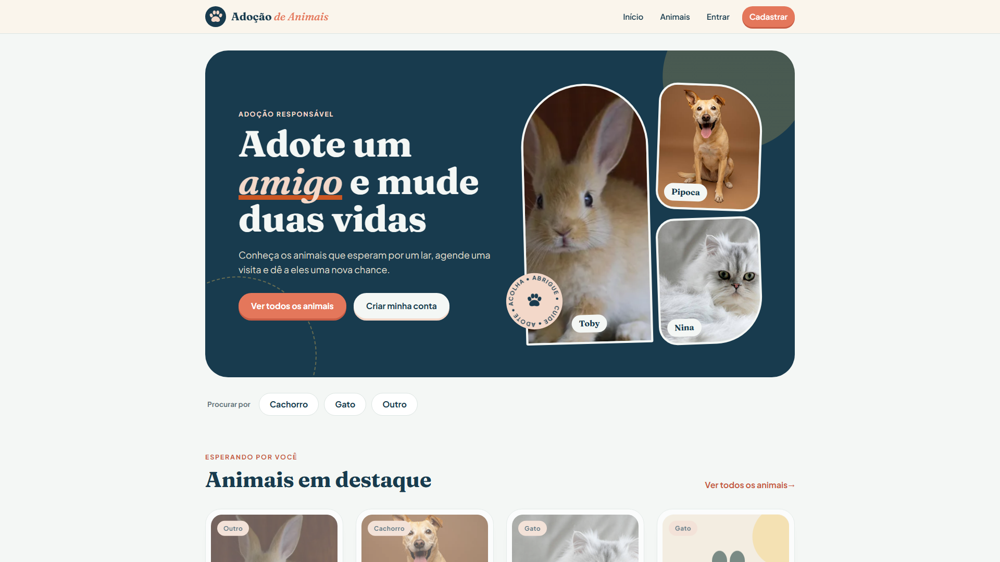
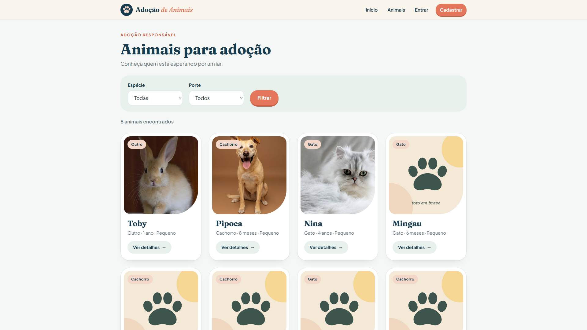
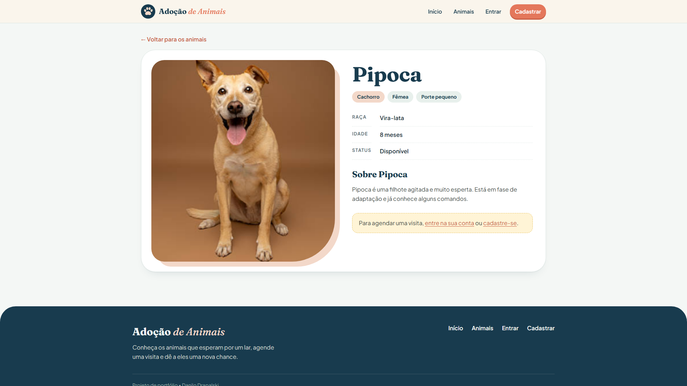
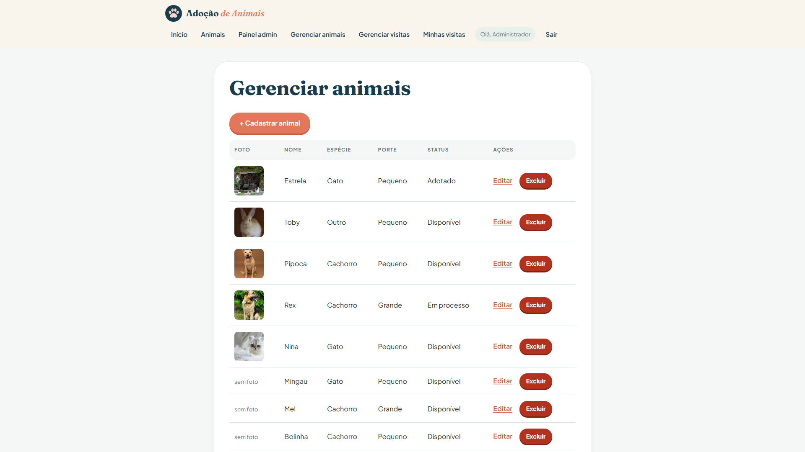

# 🐾 Site de Adoção de Animais

Sistema web para conectar animais que precisam de um lar a pessoas interessadas em adotar. Os animais ficam cadastrados em um painel administrativo e, na parte pública, qualquer pessoa pode conhecê-los e agendar uma visita.

Projeto desenvolvido por **Danilo Drapalski** para praticar desenvolvimento web com **PHP puro, MySQL e boas práticas de segurança**, sem frameworks.

> 🚧 **Status:** em desenvolvimento. Veja a tabela de [funcionalidades](#-funcionalidades) para saber o que já está pronto.

---

## 📑 Sumário

- [Funcionalidades](#-funcionalidades)
- [Tecnologias](#-tecnologias)
- [Segurança](#-segurança)
- [Prints](#-prints)
- [Como rodar o projeto](#-como-rodar-o-projeto)
- [Estrutura de pastas](#-estrutura-de-pastas)
- [Banco de dados](#-banco-de-dados)
- [Próximas melhorias](#-próximas-melhorias)
- [Autor](#-autor)

---

## ✅ Funcionalidades

O sistema tem três tipos de acesso: **visitante**, **usuário** e **administrador**.

| Funcionalidade | Quem usa | Status |
|---|---|---|
| Cadastro de conta (senha criptografada) | Visitante | ✅ Pronto |
| Login e logout | Usuário e admin | ✅ Pronto |
| Menu que muda conforme o tipo de acesso | Todos | ✅ Pronto |
| Painel administrativo protegido | Admin | ✅ Pronto |
| Cadastrar, editar e excluir animais | Admin | ✅ Pronto |
| Upload de foto do animal (JPG/PNG) | Admin | ✅ Pronto |
| Controle de status (disponível, em processo, adotado) | Admin | ✅ Pronto |
| Página inicial com animais em destaque | Todos | ✅ Pronto |
| Listagem de animais em cards, com filtros por espécie e porte | Todos | ✅ Pronto |
| Página de detalhes do animal | Todos | ✅ Pronto |
| Agendamento de visita (sem data passada e sem horário repetido) | Usuário | 🔲 Em andamento |
| "Minhas visitas" (ver e cancelar) | Usuário | 🔲 Em andamento |
| Gerenciar visitas (confirmar ou recusar) | Admin | 🔲 Em andamento |

### O que cada perfil pode fazer

- **Visitante:** conhecer os animais disponíveis e criar uma conta.
- **Usuário:** tudo do visitante, mais agendar e acompanhar visitas.
- **Administrador:** gerenciar os animais e as visitas.

---

## 🛠 Tecnologias

- **PHP 8** (puro, sem framework)
- **MySQL** com **PDO**
- **HTML5**, **CSS3** e **JavaScript**
- **WampServer** (Apache + MySQL + PHP) como ambiente local
- **Git** e **GitHub** para versionamento

---

## 🔒 Segurança

Mesmo sendo um projeto de estudo, foram aplicadas práticas usadas em sistemas reais:

- **SQL Injection:** todas as consultas usam PDO com `prepare()` e `execute()`.
- **Senhas:** guardadas com `password_hash()` e conferidas com `password_verify()`. Nenhuma senha fica salva em texto puro.
- **Sessão:** `session_regenerate_id()` no login, para evitar fixação de sessão.
- **XSS:** todo texto exibido na tela passa por `htmlspecialchars()` (função `e()`).
- **Upload de imagem:** o conteúdo real do arquivo é verificado (não só a extensão), só JPG e PNG são aceitos, há limite de 2 MB e o arquivo é renomeado com nome aleatório.
- **Controle de acesso:** páginas do painel exigem login de administrador no servidor, não só um link escondido no menu.
- **Exclusões:** feitas somente por requisição `POST`, nunca por link comum.
- **Mensagens de login genéricas:** o erro não revela se o e-mail existe ou não.
- **Dados de conexão fora do Git:** `config/conexao.php` está no `.gitignore`.

---

## 📸 Prints

> Os prints serão adicionados quando as telas principais estiverem prontas, na pasta `docs/prints/`.

| Página inicial | Listagem de animais |
|---|---|
|  |  |

| Detalhes do animal | Painel do admin |
|---|---|
|  |  |

---

## 🚀 Como rodar o projeto

### Pré-requisitos

- [WampServer](https://www.wampserver.com/) (ou XAMPP) com PHP 8 ou superior
- [Git](https://git-scm.com/)
- Extensão `fileinfo` do PHP ativada (já vem ativada na maioria das instalações)

### Passo a passo

**1. Clone o repositório dentro da pasta `www` do WampServer:**

```bash
cd C:\wamp64\www
git clone https://github.com/danilodrapalski/site-adocao-animais.git
```

**2. Crie o arquivo de conexão com o banco.**
Copie `config/conexao.exemplo.php` para `config/conexao.php` e confira os dados. No WampServer padrão, o usuário é `root` e a senha fica vazia.

**3. Crie o banco de dados.**
Abra o phpMyAdmin (`http://localhost/phpmyadmin`), vá na aba **Importar** e selecione `database/banco.sql`. Ele já cria o banco `adocao_animais` e as tabelas.

**4. (Opcional) Importe animais de exemplo.**
Na aba SQL do phpMyAdmin, execute o conteúdo de `database/dados-exemplo-animais.sql`.

**5. Abra o site no navegador:**

```
http://localhost/site-adocao-animais/
```

### Como criar um administrador

Por segurança, o cadastro pelo site **sempre** cria usuários comuns. Para ter um admin:

1. Cadastre uma conta normalmente pelo site.
2. No phpMyAdmin, execute (trocando pelo seu e-mail):

```sql
UPDATE usuarios SET tipo = 'admin' WHERE email = 'seu-email@exemplo.com';
```

3. Saia e entre de novo. O menu passa a mostrar as opções de administrador.

---

## 📁 Estrutura de pastas

```
site-adocao-animais/
├── admin/
│   ├── animais/          # CRUD de animais (listar, cadastrar, editar, excluir)
│   └── index.php         # painel do administrador
├── config/
│   ├── conexao.exemplo.php   # modelo de conexão (o real fica fora do Git)
│   └── conexao.php           # dados reais (ignorado pelo Git)
├── css/
│   └── style.css
├── database/
│   ├── banco.sql                   # estrutura do banco
│   └── dados-exemplo-animais.sql   # animais fictícios para teste
├── includes/
│   ├── auth.php          # sessão, login e controle de acesso
│   ├── animais.php       # validação e upload de fotos
│   ├── card_animal.php   # card reutilizado na home e na listagem
│   ├── header.php
│   └── footer.php
├── img/                  # imagem padrão para animal sem foto
├── uploads/              # fotos dos animais
├── animais.php           # listagem pública com filtros
├── animal.php            # página de detalhes do animal
├── cadastro.php
├── index.php
├── login.php
└── logout.php
```

---

## 🗄 Banco de dados

O banco `adocao_animais` tem 3 tabelas:

- **usuarios:** nome, e-mail (único), senha (hash) e tipo (`usuario` ou `admin`).
- **animais:** nome, espécie, raça, idade, porte, sexo, descrição, foto e status (`disponivel`, `em_processo` ou `adotado`).
- **visitas:** liga um usuário a um animal, com data, horário e status (`pendente`, `confirmada`, `recusada` ou `cancelada`). Ao excluir um usuário ou animal, as visitas dele são removidas junto.

Um horário só pode ser marcado uma vez por animal. Visitas recusadas ou canceladas liberam o horário de novo.

---

## 🔮 Próximas melhorias

- Favoritar animais
- Formulário de interesse em adotar
- Histórico de adoções
- E-mails de confirmação de visita
- Painel com estatísticas
- Mapa das ONGs parceiras
- Token CSRF nos formulários

---

## 👤 Autor

**Danilo Drapalski**

- GitHub: [github.com/danilodrapalski](https://github.com/danilodrapalski)
- LinkedIn: [linkedin.com/in/danilodrapalski](https://linkedin.com/in/danilodrapalski)

> Projeto criado para fins de estudo e portfólio. Fotos e dados dos animais são fictícios.
